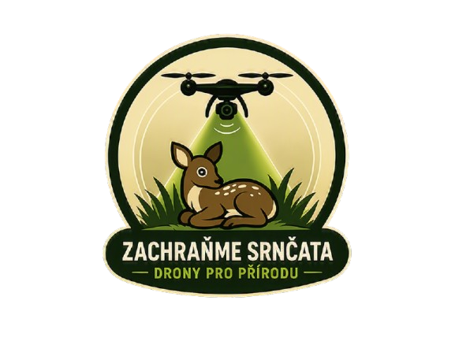

<div align="center">



# Zachraň zvíře před sekačkou Rožnovsko a okolí z.s.

**Chráníme volně žijící zvěř před zemědělskou technikou za pomoci moderních termovizních dronů a dobrovolníků.**

[](https://mapy.cz)
[](https://or.justice.cz)
[](https://or.justice.cz)
[](https://dji.com)
[](https://caa.cz)

---

</div>

## 🌿 O našem spolku

Každé jaro probíhá na loukách senoseč v době, kdy samice srnčí i další zvěře kladou svá mláďata do vysoké trávy. Přirozeným instinktem čerstvě narozeného srnčete v ohrožení není útěk, ale přitisknutí se k zemi a vyčkávání. Tento obranný mechanismus, který v přírodě chrání před predátory, je však při střetu s moderní rychlou zemědělskou technikou fatální.

Spolek **Zachraň zvíře před sekačkou Rožnovsko a okolí z.s.** vznikl proto, aby propojil ochránce přírody, zkušené piloty bezpilotních letadel, myslivce a zemědělce. Působíme v oblasti **Rožnova pod Radhoštěm, Valašska a okolí**.

> *„Hlavním účelem spolku je ochrana přírody a krajiny, pomoc při ochraně volně žijící zvěře, zejména zvěře ohrožené zemědělskou činností.“*  
> — **Ze stanov spolku (zapsáno u KS v Ostravě dne 23. října 2026)**

---

## 🚁 Jak pomáháme v praxi

Naše záchranné akce probíhají přímo v terénu v těsné koordinaci před vjezdem traktorů a žacích strojů na louky.

```
  [04:30 Ráno]           [Průzkum]              [Lokalizace]            [Šetrná záchrana]
   Příjezd týmu    ➜   Vzlet dronu s    ➜    Přesné navedení    ➜    Vynesení v boxech
  a příprava techniky   termokamerou        pozemní hlídky GPS       mimo sečenou plochu
```

1. **Ranní lety za svítání (kolem 4:30 – 5:00):**  
   Termovize funguje nejlépe, když je půda po noci studená a tělesné teplo mláďat je v kontrastu s okolím okamžitě patrné.
2. **Skenování dronem s termovizí:**  
   Pilot systematicky prolétává celou plochu louky a prověřuje tepelné anomálie.
3. **Navádění pozemního týmu:**  
   Přes vysílačky a GPS navádíme dobrovolníky a myslivce přímo k místu lehu zvířete.
4. **Zásada šetrné manipulace:**  
   Zvířata jsou přenášena výhradně v rukavicích za použití trsů trávy do čistých, prodyšných přepravních boxů, aby na mláděti neulpěl lidský pach a matka jej po seči neodvrhla.
5. **Bezpečný návrat do přírody:**  
   Po posečení a odjezdu techniky jsou mláďata bezpečně vypuštěna zpět.

---

## 🛰️ Technika a bezpečnost

Při záchranných akcích dbáme na vysokou technologickou úroveň a stoprocentní soulad s platnou legislativou:

- **Termovizní dron:** DJI Mavic 3 Enterprise Thermal (M3T) s vysokým rozlišením radiometrické termovize 640×512 px a optickým teleobjektivem pro ověření bez plašení zvěře.
- **Split-Screen zobrazení:** Souběžné sledování infračerveného i reálného optického obrazu na ovládací jednotce.
- **Pozemní výbava:** Terénní radiostanice, mobilní nabíjecí stanice pro nepřetržitý provoz a speciální prodyšné záchranné boxy.
- **Oficiální licence:** Všichni naši piloti disponují platnými zkouškami dálkově řídícího pilota ÚCL (Úřad pro civilní letectví) dle standardů EASA (kategorie A1/A3).
- **Bezpečnost provozu:** Registrovaný provozovatel dronů s platným EASA ID, pojištěním odpovědnosti z provozu a respektem k pravidlům chráněných krajinných oblastí (CHKO Beskydy).

---

## 🤝 Spolupráce a zapojení

Úspěšná záchrana je vždy výsledkem společné práce všech zapojených stran:

- 🚜 **Pro zemědělce:**  
  Nahlaste nám plánované sečení s předstihem (ideálně 2–3 dny předem). Společně naplánujeme ranní kontrolu luk tak, aby nebyl zpožděn váš harmonogram. Předcházíme tak nejen zbytečným úhynům, ale také poškození strojů a znehodnocení krmiva (riziko botulismu).
- 🌲 **Pro myslivce a honitby:**  
  Myslivecká sdružení nejlépe znají terén a pohyb zvěře. Nabízíme technologické zázemí, termovizní drony a pozorovací data shora pro efektivnější vyhledání.
- 🙋‍♂️ **Pro dobrovolníky a piloty:**  
  Hledáme nadšence do terénních ranních hlídek i piloty s vlastní technikou, kteří chtějí smysluplně pomoci přírodě.

---

## 💻 Projekty v organizaci na GitHubu

| Repozitář | Popis | Stav |
| :--- | :--- | :--- |
| **[web](https://github.com/srncataroznovsko/web)** | Zdrojové kódy oficiální webové prezentace spolku (Bootstrap 5, GitHub Pages). | 🟢 Aktivní |
| **[.github](https://github.com/srncataroznovsko/.github)** | Globální profil organizace a společná konfigurace GitHub repozitářů. | 🟢 Aktivní |

---

## 📋 Oficiální a úřední údaje

| Údaj | Hodnota |
| :--- | :--- |
| **Název spolku** | Zachraň zvíře před sekačkou Rožnovsko a okolí z.s. |
| **Právní forma** | Spolek (zapsáno 23. října 2026) |
| **Spisová značka** | L 22940 vedená u Krajského soudu v Ostravě |
| **IČO** | `30117194` |
| **Datová schránka** | `igw5uj7` |
| **Sídlo spolku** | č.p. 721, 756 27 Valašská Bystřice |
| **Působnost** | Rožnov pod Radhoštěm, Valašsko a přilehlé okolí |

---

## 📬 Kontaktujte nás

Budeme rádi za jakoukoli zprávu, navázání spolupráce či dotaz:

- 🌐 **Webová prezentace:** [srncataroznovsko.github.io/web](https://srncataroznovsko.github.io/web/)

---

<div align="center">
  <small>💚 <em>Každý zachráněný život v trávě má smysl. Děkujeme, že pomáháte s námi chránit přírodu!</em></small>
</div>
